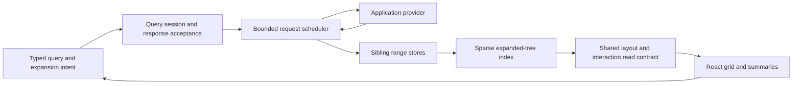

# Remote datasets with server-side grouping

Date: 2026-11-19
Status: draft — research-backed proposal, not approved for implementation
Baseline: `0.21.0` (`14f0430d32279f283dcfcb6f09662225548fe4fd`)
Implementation plan: none; focused design decisions must be reviewed first
Evidence: [research report](../../research/2026-11-19-remote-datasets-research.md)
Product priority: [roadmap](../../../ROADMAP.md)

## Confirmed direction and open scope

The user requires **server-side grouping in the first release**. A flat remote
cache alone is not an acceptable first release. Existing local and manual
server-data modes remain supported. Live subscriptions, revisioned mutations,
and durable history are separate designs, not implied by remote reads.

Recommended first release: grouped, read-only remote browsing with server
sorting/filtering/aggregation, range access, exact sibling counts, bounded
residency, explicit loading/retry, and coherent refresh. Whether loaded remote
leaves must support editing is a pending product question; the write boundary
below makes the consequences explicit. No new public type names are frozen.

## User outcome

An application supplies columns and a transport-neutral provider. A reader
groups orders by region then customer, filters by status, sorts group revenue,
expands a customer, and scrolls its orders without downloading the full dataset.
The grid schedules only needed sibling ranges, preserves the visible anchor,
shows server totals for whole groups, retries failed branches independently,
and stays within an explicit memory budget.

Acceptance example: with one million matching leaf records, show 20 regions,
expand one region with 10,000 customers and one customer with 50,000 orders.
Only the viewport and bounded nearby blocks become resident. Closing and
reopening branches must not change their aggregates, enumerate all descendants,
or turn previously selected IDs into different records.

## Existing constraints

The current snapshot exposes materialized `data` and `group` entries; group
counts and aggregates are synchronous values. External authority covers sort
and filter, and window metadata describes one contiguous flat span. The current
window geometry deliberately rejects grouping. Copy/CSV consume loaded entries,
and editing clears when its row disappears.

These are explicit contracts, not implementation accidents to bypass with fake
rows or casts. The source evidence and current behavior are recorded in the
[research report](../../research/2026-11-19-remote-datasets-research.md#pretable-baseline-reusable-behavior-and-incompatible-assumptions).

## Approaches considered

| Approach                                                           | Strength                                                                                       | Cost / limitation                                                                               | Decision                                                            |
| ------------------------------------------------------------------ | ---------------------------------------------------------------------------------------------- | ----------------------------------------------------------------------------------------------- | ------------------------------------------------------------------- |
| Provider-backed sparse hierarchical row model                      | Branch paging, server aggregates, geometry, and interaction share one authoritative projection | Requires explicit read/slot contracts and careful compatibility work                            | Recommended                                                         |
| Application-managed controller around existing `rows`/window props | Small API addition; useful for flat adapters                                                   | Cannot represent sparse grouped branches using the current flat offset and loaded-only snapshot | Keep as existing escape hatch; insufficient for this release        |
| Server returns the flattened expanded tree                         | Server can supply display ranks directly                                                       | Couples every expansion to backend UI state and makes the server own presentation hierarchy     | Possible future specialized adapter, not the general first contract |

## Proposed architecture

1. **Provider protocol:** validates supported query semantics, opens a result
   session, reads a branch range, obtains compatible summaries, and releases
   resources. It knows transport and backend; it does not know scroll pixels.
2. **Controller:** owns request lifetimes, acceptance checks, priority, retries,
   cache admission, disposal, and atomic publication. Network work stays outside
   the render/read path.
3. **Sparse hierarchical index:** maps sibling ordinals and expansion into
   display ranks. It owns no HTTP code and allocates no object per unseen row.
4. **Read/interaction adapter:** exposes materialized nodes and non-data slots,
   stable identity, navigation, and coverage. Existing local snapshots retain
   their meaning; the remote model must not fake unsupported local mutations.
5. **React presentation:** reuses columns, formatting, group controls, skins,
   summaries, and accessibility conventions while adding branch loading/errors.

The public boundary should be an explicit remote model/read capability, not a
provider forced to implement every method of the mutable local row model.
Whether shared read interfaces are extracted or adapted internally is a focused
API-review decision. No silent breaking change to `range`, `sourceRowCount`, or
`PretableVisibleRow` is permitted. New slots must not reach existing user data-row
renderers as if they contained a `TRow`.

## Query and provider semantics

A session describes:

- Dataset/source identity and an opaque authorization-scope identity; credentials
  are never part of diagnostic keys or persisted views.
- Schema/comparison version, typed filter expression, ordered grouping columns,
  ordered leaf sorts, explicit group sibling sorts, and effective aggregate
  definitions. Versioned registry keys describe custom semantics, never closures. Changing
  a registered implementation advances its semantic version. Include search,
  projection, locale/collation, and other data-changing inputs when supported;
  an adapter must declare all dependencies used to resolve its query.
- Supported operators/fields/aggregate IDs and limits. Unsupported combinations
  return a typed diagnostic before querying; no silent local approximation.
- A result consistency token and expiry/release behavior.

A branch read addresses a half-open sibling interval `[start, end)` in one
ordered group route. Root uses an empty route. The response carries the same
session/token, route, interval, exact sibling count, and entries appropriate to
that level: group nodes until the final grouping level, leaf records afterward.
A short result is valid only at the proven end; an empty middle interval is not
silently interpreted as exhaustion. Reject duplicate/conflicting node IDs,
wrong routes/levels, counts smaller than the returned extent, and mixed tokens.
Across responses for the same token, route, scope, and aggregate definition,
repeated resolved counts/aggregate answers and overlapping entries must agree. A contradiction is a session-consistency error,
not a last-response-wins merge.

Use canonical typed route segments containing grouping column identity and key
identity. Distinguish `null`, empty text, number `1`, text `"1"`, and separator
characters. Server-defined collation/bucketing must provide a stable canonical
group key; a formatted label is never identity. Leaf IDs remain stable source
record IDs. Group and leaf identities occupy distinct namespaces. Expansion is
keyed by group identity and grouping definition, not the current row position.

Filtering applies to leaves before grouping. Group aggregates cover all matching
descendant leaves, independent of expansion and cached pages. Group sibling
sorts may reference group keys or declared aggregates; leaf sorts operate within
a leaf branch. Both need deterministic tie-breaking by stable identity and
explicit comparison/null-order semantics. A sort that cannot apply at a given
level follows a documented rule or is rejected; it is never guessed locally.

The backend owns authorization, field/operator allowlists, query execution,
indexing, and resource limits. The reference adapter must use parameterized
queries and trusted schema mappings; a client field ID is not a SQL identifier.

## Identities and consistency

Keep five concepts separate:

| Identity                | Purpose                                                                       |
| ----------------------- | ----------------------------------------------------------------------------- |
| Query key               | Semantic request: dataset/auth/schema/filter/group/sort/aggregate definitions |
| Generation              | A controller lifecycle; revisiting A after A→B is a new generation            |
| Result token            | Server-enforced membership/order/value/count/aggregate version                |
| Branch route            | Which sibling collection is being addressed                                   |
| Request/range ownership | Which attempt may publish a particular range                                  |

A request may commit only if all relevant identities still match. Apply the same
checks to errors, cache hits, retries, and summary results. Independent ranges
may finish out of order; one global last-request counter must not discard valid
parallel branch reads. Aborting obsolete work is an optimization, not proof that
its result cannot arrive. Tests must include providers that ignore abort.

Recommended initial consistency guarantee: a provider either serves the accepted
result token consistently or rejects it as invalid/expired. It may implement
this through immutable/materialized results, versioned reads, or an atomically
checked revision fence that rejects changed data. A revision fence is not a
retained snapshot and can cause frequent restarts under sustained writes; this
tradeoff must be visible. A token echo without backend enforcement is invalid. A revision-fenced adapter
checks the fence and reads entries, counts, and aggregates in one coherent
server read; every write that can change those results advances the fence. A
revision check before an unrelated query is insufficient.
Do not prescribe a database transaction held open indefinitely by a browser.

Latest-read/best-effort sessions are a possible later capability. They must not
claim stable positional selections or coherent cross-branch aggregates. The
existing application-managed mode remains available for such backends.

A query change creates a new generation and session. Keep the old visible result
as a clearly labelled stale view while the new root is pending, within the same
memory budget. Do not merge its children or aggregates into the new session.
Commit the new root atomically, then revalidate retained expansion intent by
identity and load only visible descendants. On expiry, retain the old read-only
view as stale and offer/retry bounded refresh; never report an empty dataset.
On authorization-scope change, clear old data immediately rather than keeping
sensitive rows as a stale view. Server authorization remains authoritative. An authoritative session/auth
revocation response also clears protected cached/stale results, summaries, and
selection/focus state even if the client has not changed its scope identifier.
Ordinary transient or range-local failures do not imply such revocation.

## Counts, aggregates, and summary integration

Never overload one count for all of these:

- Immediate sibling count: extent of a branch request.
- Matching descendant leaf count: a group statistic, not child pagination size.
- Total matching leaves: filtered dataset count.
- Display extent: group rows plus the currently expanded hierarchy.
- Resident and rendered counts: memory and viewport observations.

The recommended first slice requires exact immediate-child counts and range
addressability for each opened branch. An unknown count is not zero. Unknown-
count/cursor-only branches need a separate continuation/navigation mode and are
deferred rather than simulated with an invented full scrollbar.

Group aggregate answers include definition identity, result token, scope, and
explicit availability/completeness. Do not average per-page averages or fold
cached children to claim a server group total. A failed aggregate is unavailable
or error, not numeric zero. Loading child records leaves an already compatible
server aggregate intact.

Preserve `0.21.0` summary scopes and keyed answers. Build request keys from the
remote query/result identity and scope, and preserve `aggregateDefinitionKey`.
Filtered totals are computed before collapse; all-scope server totals refer to
the same authorized base dataset with user filters removed. A token for a filtered
materialized result does not automatically identify that unfiltered population.
Require an explicit same-version base-dataset summary capability; without it,
all-scope support produces unavailable, never a guessed loaded total. Group
aggregates and grand totals are different addresses sharing provenance rules.
Presentation changes such as column widths do not invalidate server aggregates.

## Sparse tree and viewport behavior

Represent unseen siblings as compressed intervals, not millions of placeholder
objects. Use an ordered index with subtree display extents to map viewport demand
to branch-relative ranges. Expansion affects the projection, not branch order.
Default to collapsed groups; do not recursively fetch everything for expand-all.
Expansion of unseen groups is a bounded intent to resolve when discovered.

An expanded known group contributes its exact child count, plus the extra extents
of known expanded descendants. Until an opened branch's count is known, it has
an explicit local loading state rather than a fabricated dataset extent. Root
leaf count alone never establishes global display ranks. Restored expansion
paths are resolved incrementally; never infer unknown descendant topology.

Render slots distinguish materialized group/leaf, unloaded, loading, and failed
range. All have stable presentation keys; only real records have record IDs.
Loading/error slots participate in geometry and recovery, not editing, checkbox
selection, aggregation, clipboard, or CSV.

Variable-height rows remain a design requirement because they are a Pretable
strength. Estimate unloaded spans, measure loaded rows, and preserve a stable
visible-node ID plus intra-row offset. A seek promises convergence to an
addressed row, not exact initial pixels before measurement. Test ancestor
expansion, eviction/refetch, width changes and row-height corrections separately.
A prototype must also bound browser scroll-height effects at very large logical
extents; do not claim unlimited scrolling from sparse storage alone.

Collapsing a branch removes its visible extent immediately, parks descendant
focus on the parent, and cancels unneeded demand. A late child response cannot
reopen it. Its payload may remain in a bounded cache; expansion intent and minimal
ancestor metadata are accounted for separately. Branch-store eviction releases
request/cache objects and payloads, not topology/counts still required by the
expanded projection. Retained topology has its own cap covering nodes and
ancestor depth. The store cap and expansion cap are independent; exceeding the
store cap evicts inactive store payload, while inability to retain required
topology refuses new expansion with an explicit capacity reason. Any eviction that invalidates a
positional projection also invalidates dependent ranges, never repaints them onto
neighbors. Stable-ID restoration is preferred.

## Request scheduling, cache, and failure policy

Use one authoritative cache owner. A TanStack Query adapter may provide transport
integration, but two independent retention/refetch policies must not silently
multiply row residency. Prioritize focused/visible ranges, then overscan, then
optional prefetch. Deduplicate identical requests and merge compatible adjacent
ranges only within provider limits. Coalesce rapidly superseded scroll demand.

Provisional engineering targets, to validate before freezing public defaults:

| Resource                            | Initial target / invariant                                                                            |
| ----------------------------------- | ----------------------------------------------------------------------------------------------------- |
| Fetch size                          | 100 siblings; provider/configuration bounded maximum of 1,000                                         |
| Requests                            | At most 4 active reads and 64 queued demands; newest visible demand supersedes obsolete prefetch      |
| Payload cache                       | At most 5,000 resident entries and 32 MiB accounted payload across all branches and retained sessions |
| Store metadata                      | At most 256 active branch stores and 2,048 expansion overrides; exhausted capacity is explicit        |
| Measurements and selection metadata | Separate configurable finite caps, with diagnostics; never hidden behind a page-count limit           |
| Sessions                            | At most current plus one retiring stale session, sharing the global budget                            |

Accounted bytes are an estimate with an adapter sizing hook, not a claim about
exact JavaScript heap usage. Heap evidence must accompany row/metadata counters.
In-flight payloads and old immutable roots need separate bounded accounting;
consumers retaining snapshots are outside the controller's ownership and must
have documented costs.

Protect the visible working set and required ancestor/focus metadata. Reduce
prefetch/overscan first; evict cold collapsed/offscreen payload next. If a budget
cannot admit the visible page or one oversized record, surface a capacity error
with recovery/configuration guidance; do not oscillate fetch/evict indefinitely.
Do not silently discard selections or collapse user-visible branches to satisfy
a hidden limit. Expansion beyond a metadata cap is refused with an explanation.

Retry transient reads with bounded backoff and attempt/time limits; user retry
is available per failed range. Unsupported queries, permission failures, malformed
responses, and token expiry are not generic transient retries. Unrelated branches
stay usable for range-local failures; session consistency violations, token
expiry, and authorization revocation use their wider recovery policy. Refresh of a single branch may reuse the session only if the provider
can still serve that exact token; a new token replaces the coherent session,
including ancestor counts/aggregates. Disposal aborts, releases resources, drops
listeners, and prevents all late publication, including under React StrictMode.

## Selection, copy, export, and editing boundaries

First proposal: explicit selected leaf IDs and loaded group focus, with selection
stored separately from evictable payloads. Header select-all is explicitly
**loaded records**, not every matching server record. Subtree/query-wide selection
rules and bulk mutations are deferred. Group checkboxes must not imply complete
selection of unloaded descendants.

Cell ranges require a stable projection and coverage. Retain endpoints/IDs, but
mark ranges unresolved when required data or rank evidence is absent. Expand,
collapse, refresh, and same-size membership changes must not reinterpret an old
flat span as a new selection. An unsupported remote range operation returns a
visible reason; it does not silently narrow its target.

Copy/CSV operate on explicitly materialized coverage and report omissions. Do not
reuse `range(0, logicalTotal)` to enumerate an enormous sparse result. Add a bounded
loaded iterator/read operation for serialization. A provider-backed full export
can be a future application integration. Keep summaries excluded by default as
in `0.21.0`.

Write scope is pending. Recommended initial remote model is read-only; existing
local/manual paths retain editing. If editing loaded leaves is required, add a
focused subdesign before implementation covering pinned drafts and active saves,
capacity pressure, app-owned callbacks, late acknowledgements, row version
conflicts, filter/group/sort membership changes, and ancestor invalidation. A
successful callback cannot simply patch one cell and leave its old group totals
and rank presented as current. General revisioned mutations remain separate.

## Accessibility and visible failure states

Use the shared treegrid keyboard model and explicit expand/collapse semantics.
Keep focus on the viewport while a generation-scoped navigation target loads;
restore only if the target still belongs to the accepted result. Retry controls
are keyboard reachable and do not steal focus on completion.

Derive ARIA positions from the same expanded projection used by layout, including
header rows. Use exact counts only when that projection is established; otherwise
use the appropriate unknown count and local hierarchy metadata without invented
global positions. Group leaf totals never become `aria-rowcount`. Define how
loading/error slots are exposed in the accessibility tree before implementation;
they cannot masquerade as genuine business records. Announce branch loading,
completion and failures without flooding the live region on every scroll event.

Preserve the existing global `dataState` vocabulary; add branch/range status
instead of one global error replacing the entire tree. A failed root with no
prior result shows a full error; a failed branch has local retry; a refreshing
accepted session remains readable and clearly identified as such.

## Verification and performance contract

Use deterministic provider fixtures and a controlled scheduler. A small fully
materialized tree oracle verifies rank, ordering, expansion, counts, aggregates,
selection and navigation under randomized load/evict/refresh schedules.

Required cases:

1. Typed/null/delimiter group keys, duplicate labels, duplicate IDs, contradictory
   counts, short middle pages, wrong routes, aggregate-definition mismatches.
2. A→B→A queries; same-range retries; independent requests out of order; collapse
   during fetch; auth changes; late success/error from a provider ignoring abort.
3. Stable result reads under inserts/deletes/moves, including equal-size changes;
   invalid token handling and coherent refreshed membership/counts/aggregates.
4. Deep/wide groups, distant sibling seeks, scrolling across unloaded slots,
   parent collapse with focused descendant, variable heights and anchor recovery.
5. Cache admission and pressure, metadata-cap handling, no repeated request loop,
   disposal and StrictMode, bounded old-session retention.
6. Partial copy/export, unresolved selections, summary scope/completeness, and
   unchanged existing local/manual-model behavior.
7. Chromium/WebKit keyboard and accessibility-tree checks plus real screen-reader
   checks for loading, retry, expansion, and row-position speech.

Benchmark 1M and 100M logical leaves at fixed residency, wide/deep grouping,
10,000 expansion/eviction cycles, slow/erroring reads, and rapid query changes.
Report heap, resident rows/branches, requests/amplification, stale-response drops,
visible-fill latency, and anchor displacement. Separate network delay from client
processing. Preserve the current 8 ms processing limits and measured-cadence
frame gate; never reuse local-mode evidence as proof of remote performance.
Sparse-index operations must scale with resident intervals/tree depth and viewport
work, not total unseen leaves. Proposed numeric cache targets are unmeasured;
implementation approval needs a benchmark plan with reproducible admission limits.

## Delivery slices and review decisions

All slices below contribute to **one first release containing grouping**:

1. Provider conformance fixtures and read/slot API compatibility design.
2. Query sessions, branch-range scheduler/cache, and sparse tree oracle.
3. Shared layout, group rendering, navigation, counts, summaries, and lifecycle.
4. Reference grouped adapter, documentation, consumer/type tests, accessibility
   evidence, and remote memory/performance gates.

Live invalidation/replay, cursor-only unknown-count navigation, pivot, arbitrary
tree data, master/detail, remote writes, and full-result export are later designs.
Saved views and local undo/redo retain their roadmap position; this research does
not silently approve implementing them or building a hosted backend.

Before implementation planning, resolve:

- Read-only release versus loaded-row editing and its additional guarantees.
- Range-addressable, exact-child-count providers as the first supported contract.
- Enforced result-token consistency, including practical adapter examples and
  expiry/restart behavior under sustained writes.
- Selection limits and the exact placeholder accessibility contract.
- API compatibility strategy and measured resource defaults.

This draft starts the design conversation. It is not approval to ship the proposed
API or a promise that these unmeasured limits already hold.
