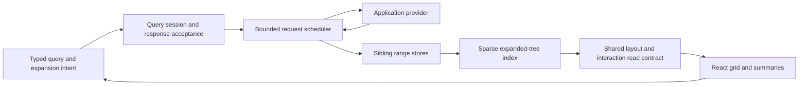

# Remote datasets with server-side grouping

Date: 2026-11-19
Status: draft — research-backed proposal, not approved for implementation
Baseline: `0.21.0` (`14f0430d32279f283dcfcb6f09662225548fe4fd`)
Implementation plan: none; focused design decisions must be reviewed first
Evidence: [research report](../../research/2026-11-19-remote-datasets-research.md)
Product priority: [roadmap](../../../ROADMAP.md)

## Confirmed scope and decision register

The user requires **server-side grouping in the first release**. A flat remote
cache alone is not an acceptable first release. Existing local and manual
server-data modes remain supported. Live subscriptions, revisioned mutations,
and durable history are separate designs, not implied by remote reads.

The user confirmed **read-only grouped browsing** and **range access with exact
child counts** on 2026-11-19. Remote editing, paste/cut/fill, write callbacks, and
revisioned mutations are excluded from this release. Selection, copy, CSV,
query changes, expansion, and refresh remain read operations.

| Decision                                | Status                 | Outcome                                                                   |
| --------------------------------------- | ---------------------- | ------------------------------------------------------------------------- |
| Server grouping in release one          | User confirmed         | Flat-only delivery is insufficient                                        |
| Read-only remote mode                   | User confirmed         | No remote editing or mutation callbacks                                   |
| Range addressing and exact child counts | User confirmed         | Cursor-only/unknown-count navigation deferred                             |
| Consistency and refresh                 | User confirmed         | Stable result version; explicit Refresh after expiry                      |
| Selection                               | User confirmed         | Result-scoped IDs; loaded-view select-all; clear on Refresh/query change  |
| Full-result server export               | User confirmed         | All matching leaf records, same result version, server group/sort order   |
| Clipboard and loaded CSV                | Design recommendation  | Complete copy or explicitly partial loaded CSV; no hidden fetching        |
| API integration and accessibility       | Design recommendations | Separate remote input/read handle; explicit loading slots                 |
| Memory policy                           | Design recommendation  | Global admission limits and bounded metadata; numbers require measurement |

Exact public names and tuned defaults are implementation-review matters, not
permission to weaken these behavioral contracts.

## User outcome

An application supplies columns and a transport-neutral provider. A reader
groups orders by region then customer, filters by status, sorts group revenue,
expands a customer, and scrolls its orders without downloading the full dataset.
The grid schedules only needed sibling ranges, preserves the visible anchor,
shows server totals for whole groups, retries failed branches independently,
and stays within an explicit memory budget.

Acceptance example: with one million matching leaf records, show 20 regions,
expand one region with 10,000 customers and one customer with 50,000 orders.
Only the viewport and bounded nearby blocks become resident. Closing and
reopening branches must not change their aggregates, enumerate all descendants,
or turn previously selected IDs into different records.

## Existing constraints

The current snapshot exposes materialized `data` and `group` entries; group
counts and aggregates are synchronous values. External authority covers sort
and filter, and window metadata describes one contiguous flat span. The current
window geometry deliberately rejects grouping. Copy/CSV consume loaded entries,
and editing clears when its row disappears.

These are explicit contracts, not implementation accidents to bypass with fake
rows or casts. The source evidence and current behavior are recorded in the
[research report](../../research/2026-11-19-remote-datasets-research.md#pretable-baseline-reusable-behavior-and-incompatible-assumptions).

## Approaches considered

| Approach                                                           | Strength                                                                                       | Cost / limitation                                                                               | Decision                                                            |
| ------------------------------------------------------------------ | ---------------------------------------------------------------------------------------------- | ----------------------------------------------------------------------------------------------- | ------------------------------------------------------------------- |
| Provider-backed sparse hierarchical row model                      | Branch paging, server aggregates, geometry, and interaction share one authoritative projection | Requires explicit read/slot contracts and careful compatibility work                            | Recommended                                                         |
| Application-managed controller around existing `rows`/window props | Small API addition; useful for flat adapters                                                   | Cannot represent sparse grouped branches using the current flat offset and loaded-only snapshot | Keep as existing escape hatch; insufficient for this release        |
| Server returns the flattened expanded tree                         | Server can supply display ranks directly                                                       | Couples every expansion to backend UI state and makes the server own presentation hierarchy     | Possible future specialized adapter, not the general first contract |

## Proposed architecture

1. **Provider protocol:** validates supported query semantics, opens a result
   session, reads a branch range, obtains compatible summaries, and releases
   resources. It knows transport and backend; it does not know scroll pixels.
2. **Controller:** owns request lifetimes, acceptance checks, priority, retries,
   cache admission, disposal, and atomic publication. Network work stays outside
   the render/read path.
3. **Sparse hierarchical index:** maps sibling ordinals and expansion into
   display ranks. It owns no HTTP code and allocates no object per unseen row.
4. **Read/interaction adapter:** exposes materialized nodes and non-data slots,
   stable identity, navigation, and coverage. Existing local snapshots retain
   their meaning; the remote model must not fake unsupported local mutations.
5. **React presentation:** reuses columns, formatting, group controls, skins,
   summaries, and accessibility conventions while adding branch loading/errors.

### API compatibility recommendation

Add a distinct remote input mode to the existing React surface (conceptually
`remoteModel`), mutually exclusive with `rows` and the existing local `model`.
Keep the current public local model and its snapshot union unchanged. Adapt
local and remote models to an internal shared layout/navigation read contract;
introduce an explicit remote read-slot type rather than adding placeholders to
`PretableVisibleRow` or pretending they contain a `TRow`.

The remote handle exposes query, expansion, selection, refresh, retry, loaded
serialization and diagnostics. It does not expose local mutation/edit commands.
Remote props reject top-level mutation/edit/paste callbacks at type level; runtime callers
bypassing types receive a configuration error before rendering. No successful
no-op mutation methods. The model owns lifecycle and cache; React subscribes to
immutable views and declares viewport demand outside render. Disposal is explicit
for headless ownership and managed by the React owner when it creates a model.

Prefer one new public remote model entry point through `@pretable/core` and React
bindings through `@pretable/react`, with implementation modules isolated from the
local model. Final symbol names and packaging must pass API-report and packed
consumer review. Additive input overloads must preserve inference for existing
rows/model consumers and compile-time exclusion of incompatible options.

## Query and provider semantics

A session describes:

- Dataset/source identity and an opaque authorization-scope identity; credentials
  are never part of diagnostic keys or persisted views.
- Schema/comparison version, typed filter expression, ordered grouping columns,
  ordered leaf sorts, explicit group sibling sorts, and effective aggregate
  definitions. Versioned registry keys describe custom semantics, never closures. Changing
  a registered implementation advances its semantic version. Include search,
  projection, locale/collation, and other data-changing inputs when supported;
  an adapter must declare all dependencies used to resolve its query.
- Supported operators/fields/aggregate IDs and limits. Unsupported combinations
  return a typed diagnostic before querying; no silent local approximation.
- A result consistency token and expiry/release behavior.

A branch read addresses a half-open sibling interval `[start, end)` in one
ordered group route. Root uses an empty route. The response carries the same
session/token, route, interval, exact sibling count, and entries appropriate to
that level: group nodes until the final grouping level, leaf records afterward.
A short result is valid only at the proven end; an empty middle interval is not
silently interpreted as exhaustion. Reject duplicate/conflicting node IDs,
wrong routes/levels, counts smaller than the returned extent, and mixed tokens.
Across responses for the same token, route, scope, and aggregate definition,
repeated resolved counts/aggregate answers and overlapping entries must agree. A contradiction is a session-consistency error,
not a last-response-wins merge. Opening the session supplies the exact root
sibling count. Every group node supplies its exact immediate-child count before
it can be expanded; fetching children must confirm that count for the same token.
This prevents an expanded-but-uncountable branch in the first supported mode.
Count computation can be expensive; the provider may cache it by result token,
but must not substitute an estimate or a descendant leaf count.

Use canonical typed route segments containing grouping column identity and key
identity. Distinguish `null`, empty text, number `1`, text `"1"`, and separator
characters. Server-defined collation/bucketing must provide a stable canonical
group key; a formatted label is never identity. Leaf IDs remain stable source
record IDs. Group and leaf identities occupy distinct namespaces. Expansion is
keyed by group identity and grouping definition, not the current row position.

Filtering applies to leaves before grouping. Group aggregates cover all matching
descendant leaves, independent of expansion and cached pages. Group sibling
sorts may reference group keys or declared aggregates; leaf sorts operate within
a leaf branch. Both need deterministic tie-breaking by stable identity and
explicit comparison/null-order semantics. A sort that cannot apply at a given
level follows a documented rule or is rejected; it is never guessed locally.

The backend owns authorization, field/operator allowlists, query execution,
indexing, and resource limits. The reference adapter must use parameterized
queries and trusted schema mappings; a client field ID is not a SQL identifier.

## Identities and consistency

Keep five concepts separate:

| Identity                | Purpose                                                                       |
| ----------------------- | ----------------------------------------------------------------------------- |
| Query key               | Semantic request: dataset/auth/schema/filter/group/sort/aggregate definitions |
| Generation              | A controller lifecycle; revisiting A after A→B is a new generation            |
| Result token            | Server-enforced membership/order/value/count/aggregate version                |
| Branch route            | Which sibling collection is being addressed                                   |
| Request/range ownership | Which attempt may publish a particular range                                  |

A request may commit only if all relevant identities still match. Apply the same
checks to errors, cache hits, retries, and summary results. Independent ranges
may finish out of order; one global last-request counter must not discard valid
parallel branch reads. Aborting obsolete work is an optimization, not proof that
its result cannot arrive. Tests must include providers that ignore abort.

The provider consistency recommendation supporting the confirmed refresh UX is: a provider either serves the accepted
result token consistently or rejects it as invalid/expired. It may implement
this through immutable/materialized results, versioned reads, or an atomically
checked revision fence that rejects changed data. A revision fence is not a
retained snapshot and can cause frequent restarts under sustained writes; this
tradeoff must be visible. A token echo without backend enforcement is invalid. A revision-fenced adapter
checks the fence and reads entries, counts, and aggregates in one coherent
server read; every write that can change those results advances the fence. A
revision check before an unrelated query is insufficient.
Do not prescribe a database transaction held open indefinitely by a browser.

Latest-read/best-effort sessions are a possible later capability. They must not
claim stable positional selections or coherent cross-branch aggregates. The
existing application-managed mode remains available for such backends.

A query change creates a new generation and session. Keep the old visible result
as a clearly labelled stale view while the new root is pending, within the same
memory budget. Do not merge its children or aggregates into the new session.
Commit the new root atomically, then revalidate retained expansion intent by
identity and load only visible descendants. On expiry, retain the old read-only
view as stale, cancel remaining reads and present an explicit Refresh action.
Do not open a replacement session automatically. Unloaded slots explain that
Refresh is needed; they never remain on a perpetual loading spinner. Cached
rows stay readable and totals stay visibly stale, never reported as an empty
dataset. Transient reads may retry only while the accepted session remains valid.
On authorization-scope change, clear old data immediately rather than keeping
sensitive rows as a stale view. Server authorization remains authoritative. An authoritative session/auth
revocation response also clears protected cached/stale results, summaries, and
selection/focus state even if the client has not changed its scope identifier.
Ordinary transient or range-local failures do not imply such revocation.

## Counts, aggregates, and summary integration

Never overload one count for all of these:

- Immediate sibling count: extent of a branch request.
- Matching descendant leaf count: a group statistic, not child pagination size.
- Total matching leaves: filtered dataset count.
- Display extent: group rows plus the currently expanded hierarchy.
- Resident and rendered counts: memory and viewport observations.

The confirmed first slice requires exact immediate-child counts and range
addressability, including root count at session open and child count on each
group descriptor. Unknown-count/cursor-only backends receive an explicit
unsupported-capability result before the model starts. Existing manual-data mode
remains available. No client cursor walking masquerades as random access.

Group aggregate answers include definition identity, result token, scope, and
explicit availability/completeness. Do not average per-page averages or fold
cached children to claim a server group total. A failed aggregate is unavailable
or error, not numeric zero. Loading child records leaves an already compatible
server aggregate intact.

Preserve `0.21.0` summary scopes and keyed answers. Build request keys from the
remote query/result identity and scope, and preserve `aggregateDefinitionKey`.
Filtered totals are computed before collapse; all-scope server totals refer to
the same authorized base dataset with user filters removed. A token for a filtered
materialized result does not automatically identify that unfiltered population.
Require an explicit same-version base-dataset summary capability; without it,
all-scope support produces unavailable, never a guessed loaded total. Group
aggregates and grand totals are different addresses sharing provenance rules.
Presentation changes such as column widths do not invalidate server aggregates.

## Sparse tree and viewport behavior

Represent unseen siblings as compressed intervals, not millions of placeholder
objects. Use an ordered index with subtree display extents to map viewport demand
to branch-relative ranges. Expansion affects the projection, not branch order.
Default to collapsed groups; do not recursively fetch everything for expand-all.
Expansion of unseen groups is a bounded intent to resolve when discovered.

After session open, the display extent is the root sibling count plus the
immediate-child count of every admitted expanded group reachable through expanded ancestors. Each expanded group has
known identity, sibling ordinal, ancestor path and exact child count retained in
topology metadata. Those facts make the current projection exact even when most
payload slots are unloaded. Collapsed descendants contribute no extra extent.
This does not claim the count of all nodes in an infinitely expanded tree.

Before session open, display a body-level loading/error state, not indexed rows
with guessed counts. Restored expansion paths are applied only after their
ancestor descriptors/positions are known. Do not scan every branch to restore an
offscreen path; without an optional locate capability, restoration waits until
that path is encountered through ordinary demand. Root leaf count never replaces
the display extent. Expansion metadata admission is atomic with projection changes.

Render slots distinguish materialized group/leaf, unloaded, loading, and failed
range. All have stable presentation keys; only real records have record IDs.
Loading/error slots participate in geometry and recovery, not editing, checkbox
selection, aggregation, clipboard, or CSV.

Variable-height rows remain a design requirement because they are a Pretable
strength. Estimate unloaded spans, measure loaded rows, and preserve a stable
visible-node ID plus intra-row offset. A seek promises convergence to an
addressed row, not exact initial pixels before measurement. Test ancestor
expansion, eviction/refetch, width changes and row-height corrections separately.
A prototype must also bound browser scroll-height effects at very large logical
extents; do not claim unlimited scrolling from sparse storage alone.

Collapsing a branch removes its visible extent immediately, parks descendant
focus on the parent, and cancels unneeded demand. A late child response cannot
reopen it. Its payload may remain in a bounded cache; expansion intent and minimal
ancestor metadata are accounted for separately. Branch-store eviction releases
request/cache objects and payloads, not topology/counts still required by the
expanded projection. Retained topology has its own cap covering nodes and
ancestor depth. The store cap and expansion cap are independent; exceeding the
store cap evicts inactive store payload, while inability to retain required
topology refuses new expansion with an explicit capacity reason. Any eviction that invalidates a
positional projection also invalidates dependent ranges, never repaints them onto
neighbors. Stable-ID restoration is preferred.

## Request scheduling, cache, and failure policy

Use one authoritative cache owner. A TanStack Query adapter may provide transport
integration, but two independent retention/refetch policies must not silently
multiply row residency. Prioritize focused/visible ranges, then overscan, then
optional prefetch. Deduplicate identical requests and merge compatible adjacent
ranges only within provider limits. Coalesce rapidly superseded scroll demand.

Provisional engineering targets, to validate before freezing public defaults:

| Resource                            | Initial target / invariant                                                                            |
| ----------------------------------- | ----------------------------------------------------------------------------------------------------- |
| Fetch size                          | 100 siblings; provider/configuration bounded maximum of 1,000                                         |
| Requests                            | At most 4 active reads and 64 queued demands; newest visible demand supersedes obsolete prefetch      |
| Payload cache                       | At most 5,000 resident entries and 32 MiB accounted payload across all branches and retained sessions |
| Store metadata                      | At most 256 active branch stores and 2,048 expansion overrides; exhausted capacity is explicit        |
| Measurements and selection metadata | Separate configurable finite caps, with diagnostics; never hidden behind a page-count limit           |
| Sessions                            | At most current plus one retiring stale session, sharing the global budget                            |

### Admission, metadata, and snapshot ownership

Accounted bytes are an estimate with an adapter sizing hook, not exact JavaScript
heap usage. Reserve response capacity before dispatch: initial target 8 MiB per
response and at most four active reads (32 MiB reserved ingress), separately from
the 32 MiB admitted payload cache. Provider transports must enforce their response
limits; rejecting an oversized already-decoded object cannot undo its transient
allocation. Report accounted ingress, cache, metadata and sampled heap separately.
No claim of a strict process-heap cap follows from these estimates.

Initial metadata targets: at most 8,192 retained topology nodes, grouping depth
32, 2,048 expansion overrides, 10,000 explicitly selected IDs, 100,000 retained
height measurements and 8 MiB accounted metadata globally. Apply both cardinality
and accounted-size limits, including variable-length IDs and keys. These are
proposed configurable defaults awaiting benchmark validation, not hidden limits.
The 256 store objects are evictable scheduling/cache containers; topology for an
expanded branch survives their eviction and consumes its separate allowance.

Reserve capacity atomically before admitting a response or expansion. Protect the
visible working set and required ancestor/focus topology. Drop queued prefetch,
reduce overscan, and evict cold payload before refusing visible work. Refuse a new
expansion or additive selection that cannot fit; preserve the prior operation's
state and announce the limit. Never silently deselect records or collapse an
already visible branch. Height measurements can use bounded LRU eviction because
re-estimation plus anchor correction is defined; loss of a selection cannot.

If the minimum visible set exceeds configuration, show a capacity diagnostic
with Retry/Refresh and configuration guidance. Do not refetch the same rejected
page repeatedly. A changed viewport or capacity setting can retry admission;
ordinary scroll telemetry cannot create an infinite error/fetch loop. Retained
stale data and new-session admission share the cache budget. Evict offscreen stale
payload first; if retaining the old viewport prevents the new root from fitting,
release that stale body and show loading while preserving safe presentation intent.

Controller ownership retains only current published state and at most one retiring
view during a handover; no internal snapshot-history list. Persistent structures
can share data, but all controller-owned references count toward budgets until
released. External consumers that retain immutable snapshots own that extra memory;
document it and provide counters for controller retention. Tests include repeated
subscribe/unsubscribe, StrictMode and abandoned in-flight requests.

### Errors, retries, and request permits

| Failure                                            | Result behavior                                                                        | Recovery                                                                              |
| -------------------------------------------------- | -------------------------------------------------------------------------------------- | ------------------------------------------------------------------------------------- |
| Transient range read                               | Keep compatible resident data; mark only missing range failed                          | Initial attempt plus at most two automatic retries; then explicit Retry               |
| Unsupported query/capability or malformed response | Do not publish the answer                                                              | Explain the incompatible configuration; no automatic retry                            |
| Contradiction within one result token              | Invalidate that session, cancel its work, and remove its untrustworthy body/aggregates | Require a fresh session; never retain a contradicted result as trustworthy stale data |
| Expired/invalidated token                          | Freeze the coherent old result as stale; stop further reads against it                 | Explicit user Refresh; no automatic session restart                                   |
| Range-local authorization denial                   | Remove protected cached payload and selection in the denied range/branch               | Keep unrelated authorized branches; explicit retry after permission recovery          |
| Session authorization revocation                   | Clear protected cache, summaries, focus/selection and retiring results                 | Application establishes a new authorized scope/session                                |

Provisional transient retry timing is 250 ms then 1 s with bounded jitter; honor
provider retry-after only within an overall 30 s request/retry deadline. Tests use
a seeded clock. Deadlines produce a timeout state and cancellation; they never
turn an unknown network outcome into accepted data. Permission and consistency
errors are not transient failures.

The concurrency permit covers invoked, unsettled provider reads, including reads
whose abort was requested. Do not release it merely because the UI stopped caring:
a provider ignoring abort could otherwise accumulate unbounded requests while the
user scrolls. Providers must settle cancellation/deadlines; a nonconforming stalled
provider consumes its permit and reports a diagnostic instead of spawning an
unbounded replacement loop. The grid cannot prove backend computation stopped;
transport/server resource limits remain the provider's responsibility.

Refresh of a single branch may reuse a session only when the provider can still
serve that exact token; it refills missing/failed data, not newer values. New
values require a new coherent result token, including ancestor counts/aggregates.
Disposal aborts, releases provider sessions best-effort, drops listeners, clears
controller-owned data, and prevents late publication under StrictMode. Late
settlement still releases request accounting without reviving a disposed model.

## Selection, copy, export, and editing boundaries

### Confirmed selection boundary

Explicit leaf-ID selection is scoped to one accepted result session: query
identity, backend result token, and controller acceptance generation together. It survives
payload eviction and collapse within that version; cache absence is not deletion.
Show selected-ID count separately from selected rows currently materialized.
Do not expose selected record objects for unloaded IDs. No query-wide rules,
subtree checkboxes, or remote bulk-operation protocol in this release.

The header checkbox means **Select loaded rows in this view**: materialized leaf
rows in the currently expanded projection, including loaded rows outside the DOM
viewport, excluding collapsed cached descendants and stale sessions. Checking
adds those IDs; unchecking removes only those IDs. A separate Clear selection
action clears the entire retained set. Newly loaded rows are not automatically
selected. Disable the header checkbox when no eligible leaf rows are loaded.
A group row is focusable/expandable but does not select its unloaded subtree.

The user confirmed clearing ID selection and cell ranges when Refresh or a
query change begins, with one announcement. Do this even when the replacement
query returns the same backend token: a revision fence can legitimately identify
the same database version under two different filters. A failed refresh does not
restore old selections. No new selection is created in a retiring stale view
while a replacement is pending. Expiry alone retains current selection metadata
until Refresh; unresolved records remain unavailable. Column presentation and
compatible expansion intent survive. Source/auth changes clear all data-bound
intent immediately, including expansion when its namespace is no longer valid.

Cell ranges bind to `{acceptedSessionId, projectionRevision}` plus real
endpoints/columns. The session ID covers query, result token, and generation.
Keep at most 32 ranges (provisional configurable cap). Expansion/collapse changes
the projection and clears ranges with an announcement; row-ID selection survives.
Eviction alone preserves range intent within that projection but may make its
contents unavailable. Shift/drag selection cannot silently jump across unloaded
slots: report that the requested range is unavailable and retain the previous
selection. Keyboard navigation may load its target; selection does not trigger
unbounded fetches to materialize a range.

### Copy and export recommendation

Copy succeeds only when the selected cell rectangle(s), or the focused-cell
fallback, are fully materialized in the current projection. Otherwise leave the
clipboard untouched and announce that selected data is not loaded. Do not insert
blank values for missing rows or silently narrow the copied range. Successful
copy preserves existing formatting behavior. There is no automatic copy-triggered
full-result fetch.

Remote CSV exposes explicit loaded-view versus selected-loaded scope rather than
inheriting an ambiguous empty-selection fallback. Selected-loaded with zero IDs
produces no file and a visible explanation. With retained unloaded selected IDs,
export only loaded selected records and report that omission; the user invokes
an action explicitly labelled Export loaded selected rows. Loaded-view exports
materialized nodes in expanded display order using a bounded loaded iterator,
never `range(0, logicalTotal)` across an enormous sparse result.

Preserve CSV formula protection, formatting, omission metadata and partial-file
naming. Report unloaded records and collapsed groups where applicable; group
aggregate values can be complete even while the leaf export is partial. Determine
whole-result completeness from proven leaf coverage and expansion, never root
sibling count or resident count alone. Summaries remain excluded by default.
Existing local/manual CSV API behavior stays unchanged.

### Full-result server export

Full-result server export is required in the first release. The user confirmed
CSV containing all matching leaf records, in server-defined group/sort order,
from the same result version as the viewed query. Collapsed groups do not exclude
records. Group headers, group aggregates, and summary rows are excluded; grouped
report formats remain a separate future design. This action is labelled Export
all matching rows and remains distinct from the explicitly partial loaded exports.

Recommended contract: the application supplies an export-job adapter alongside
the range provider. Export creation captures the accepted query identity, result
token, semantic registry version, ordered export column IDs, and supported
serialization options. The server validates these against its own authorization
and column registry; client render functions are never transmitted or evaluated.
An exportable column needs a server serialization definition. Unsupported custom
formatting is reported before starting, never silently replaced. The adapter must
honor existing CSV formula protection and exclusion policy.

The server traverses the complete result and writes the artifact; the browser
never gathers all ranges or buffers the entire dataset. Creation uses an
idempotency key so a retried start does not create duplicate jobs. A job handle
exposes queued, running, ready, failed, cancelled, and expired states, with bounded
polling or application-managed notifications. Progress is indeterminate unless
the server supplies meaningful work counts; root sibling counts are not leaf
export totals. Explicit cancellation is best effort and its acknowledgement is
separate from local UI cancellation. A completed empty result produces a
header-only CSV with zero records, distinct from an empty selected-loaded export.

The export must pin or otherwise retain the captured result version for its job
lifetime. If that version cannot be exported, report result expiry and require
explicit Refresh followed by a new export. Never silently export latest data.
A later grid Refresh does not retarget an existing job: label its originating
query/version and creation time so the downloaded file is not mistaken for the
new view. The application owns durable job persistence, server resource limits,
artifact retention, and delivery. The grid owns the start/status/cancel/download
controls and releases its subscriptions on disposal without claiming the server
job was cancelled.

Ready metadata includes record count, captured query/version identity, filename,
format, and artifact expiry. Deliver a server download link or application-owned
download action rather than collecting bytes in grid memory. Authorization must
be checked at job creation, status, and download; source/auth replacement removes
protected job metadata and download controls. The adapter must not expose
credentials in URLs or diagnostics. Expired downloads offer explicit regeneration
only if the captured version is still available; otherwise require Refresh.

Provider conformance must cover same-version output under concurrent mutations,
collapsed and unloaded branches, deterministic ordering, excluded/custom columns,
formula protection, duplicate starts, empty results, cancellation races, expired
results/artifacts, auth revocation, and large exports with bounded browser memory.
The reference provider and demo must implement this path; a placeholder callback
alone does not satisfy the first-release requirement.

Read-only scope is confirmed. Remote cells expose read-only semantics even if a
shared column definition contains an editor configuration. Such column settings
are accepted for reuse but inert: remote mode never invokes `editable` predicates,
editor renderers, value parsers, validators, or setters. The remote mode rejects
top-level mutation/edit/paste callbacks and provides no write handle; editing gestures do not mount an
editor, and paste/cut/fill cannot dispatch writes. Copy remains available. Local
and manual-data paths keep their existing editing behavior. Future remote writes
need a separate contract for drafts, acknowledgements, membership/order changes,
conflicts and ancestor invalidation.

## Accessibility and visible failure states

Use a cell-focused, read-only treegrid. Header controls and real group/leaf cells
retain existing keyboard behavior. Loaded group rows expose expansion and level;
leaf rows never expose an expansion action. Root rows use level 1, deeper siblings
use route depth + 1. Position and set size describe immediate siblings, not leaves.

### Loading and failed slots

After root metadata is accepted, each rendered unloaded slot occupies its true
expanded-view row index. Render one row with a spanning read-only status cell
labelled Loading or Could not load; it has no record ID, checkbox, editor or
`aria-selected`. Loading slots have no fabricated group label or expanded state.
Keep each slot's row index so virtualization does not collapse the advertised
extent. Failure presentation is associated with its range and deduplicated:
place a Retry control in the first rendered failed slot for that range, not one
button per missing record. It is keyboard reachable and does not become a data
selection target. These are status representations of unavailable rows, never
synthetic business records passed to user renderers.

The visual spacer for unrendered intervals is presentation-only. Render only the
viewport's status slots, not one DOM row per missing sibling. One polite live
region announces the pending navigation target or focused branch's transition;
it does not announce every background request or spinner. Decorative skeletons
inside status cells are hidden from assistive technology.

### Pending keyboard navigation

On navigation into an unloaded slot, keep DOM focus on the grid viewport and
record `{generation, token, projectionRevision, route, siblingOrdinal, column}`.
Prioritize that range and announce loading once. A later navigation replaces this
target; Escape cancels it, and Tab may leave the grid. A completion never steals
focus after the reader leaves. Restore focus to the real cell only if the target
and projection remain valid. Collapse or query replacement cancels the target;
a loaded parent group is the fallback for collapsing descendants. On failure,
announce retry availability and let the reader navigate to Retry without an
automatic focus transfer. Root loading/error retains usable header controls.

### Counts and unknown states

For an accepted root and admitted expansion topology, `aria-rowcount` is the
exact expanded display extent plus the header, and `aria-rowindex` follows that
same projection. All rendered real/status rows use consistent one-based indices.
The known 20-region/10,000-customer/50,000-order example has display extent 60,020
when those two groups are expanded, even if only 100 payload records are resident.
It does not have one million visible rows merely because a leaf total says so.

Before root metadata exists, use a body-level loading/error state and an unknown
row count; do not invent indexed placeholder rows. Restored offscreen expansion
is pending intent, not expanded topology until ancestors are resolved. Thus exact
indices never depend on unknown subtrees. Group leaf totals are separate text.

This is the proposed implementation contract, based on the WAI-ARIA sources in
the research report, not a claim of tested screen-reader behavior. Verify with
Chromium/WebKit accessibility trees and NVDA/Firefox plus VoiceOver/Safari for
loading, failed-range Retry, sparse indices, expansion and focus restoration.
If speech or navigation proves unreliable, revise the status-slot presentation
before release while preserving semantic counts and no-fabricated-record rules.

### Lifecycle presentation

Keep global `dataState` vocabulary and add branch/range status. A failed root with
no accepted result shows a full-body error; a failed branch offers local retry.
A retained previous result carries an explicit stale caption and Refresh state.
Do not mark the whole tree busy for one branch and suppress unrelated reading.
Transient request errors preserve compatible cached values; authorization
revocation and session consistency errors follow their wider invalidation policy.

## Verification and performance contract

Use deterministic provider fixtures and a controlled scheduler. A small fully
materialized tree oracle verifies rank, ordering, expansion, counts, aggregates,
selection and navigation under randomized load/evict/refresh schedules.

Required cases:

1. Typed/null/delimiter group keys, duplicate labels, duplicate IDs, contradictory
   counts, short middle pages, wrong routes, aggregate-definition mismatches.
2. A→B→A queries; same-range retries; independent requests out of order; collapse
   during fetch; auth changes; late success/error from a provider ignoring abort.
3. Stable result reads under inserts/deletes/moves, including equal-size changes and different queries returning the same backend
   revision token; explicit Refresh returning an unchanged token still clears
   selection. Verify invalid token handling and coherent refreshed membership/counts/aggregates.
4. Deep/wide groups, distant sibling seeks, scrolling across unloaded slots,
   parent collapse with focused descendant, variable heights and anchor recovery.
5. Cache admission and pressure, metadata-cap handling, no repeated request loop,
   disposal and StrictMode, bounded old-session retention.
6. Partial copy/export, unresolved selections, summary scope/completeness, and
   unchanged existing local/manual-model behavior. Type/runtime tests reject
   top-level write callbacks in remote mode but accept shared editor-configured
   columns and prove their edit predicates/renderers/parsers/validators/setters
   are never called.
7. Chromium/WebKit keyboard and accessibility-tree checks plus real screen-reader
   checks for loading, retry, expansion, and row-position speech.

Benchmark 1M and 100M logical leaves at fixed residency, wide/deep grouping,
10,000 expansion/eviction cycles, slow/erroring reads, and rapid query changes.
Report heap, resident rows/branches, requests/amplification, stale-response drops,
visible-fill latency, and anchor displacement. Separate network delay from client
processing. Preserve the current 8 ms processing limits and measured-cadence
frame gate; never reuse local-mode evidence as proof of remote performance.
Sparse-index operations must scale with resident intervals/tree depth and viewport
work, not total unseen leaves. Proposed numeric cache targets are unmeasured;
implementation approval needs a benchmark plan with reproducible admission limits.

## Delivery slices and review decisions

All slices below contribute to **one first release containing grouping**:

1. Provider conformance fixtures and read/slot API compatibility design.
2. Query sessions, branch-range scheduler/cache, and sparse tree oracle.
3. Shared layout, group rendering, navigation, counts, summaries, and lifecycle.
4. Full-result export adapter, server job lifecycle, download UI, and conformance fixtures.
5. Reference grouped adapter, documentation, consumer/type tests, accessibility
   evidence, and remote memory/performance gates.

Live invalidation/replay, cursor-only unknown-count navigation, pivot, arbitrary
tree data, master/detail, remote writes, and grouped report exports are later designs.
Saved views and local undo/redo retain their roadmap position; this research does
not silently approve implementing them or building a hosted backend.

Remaining review and evidence gates:

- Review the remaining recommended copy/export, loading-slot, and API contracts.
- Validate provider feasibility with a coherent revision-fence reference adapter
  and an immutable-result fixture; no browser-held indefinite DB transactions.
- Measure resource defaults and accessibility behavior in implementation spikes;
  these are evidence gates, not unresolved user scope or claims of current results.

This draft records confirmed scope and recommended contracts for review. It is
not approval to ship the proposed
API or a promise that these unmeasured limits already hold.
